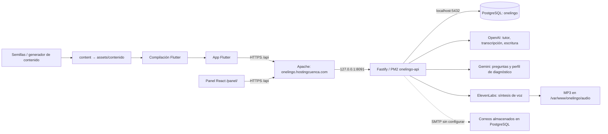

# OneLingo — auditoría técnica y documental

Fecha: 8 de septiembre de 2026. Proyecto extraído en `/home/roggrt/Documents/onelingo` desde `/home/roggrt/Descargas/onelingo.zip`. Revisión del commit `ec74f53` y del despliegue existente mediante HTTPS y SSH de solo lectura.

## 1. Dictamen

El proyecto contiene una app Flutter funcional como prototipo, un backend real Fastify/PostgreSQL, un panel React y un pipeline de contenido. No es solo una maqueta. Sin embargo, mezcla mecanismos de demostración con cuentas reales y todavía no reúne las condiciones para ofrecer cuentas y planes comerciales de forma segura.

**La prioridad es corregir la autenticación demo, la inyección de HTML en correos y recuperación, la autoridad del servidor sobre planes/progreso y la exposición de PostgreSQL.** Estos problemas tienen mayor impacto que actualizar los Markdown.

La documentación está parcialmente desactualizada y mezcla requisitos, decisiones históricas y funciones realmente implementadas. `DOCUMENTACION.md` es el documento más cercano al estado actual, pero también contiene rutas inexistentes, versiones incorrectas e instrucciones locales incompletas.

Los 18 archivos TypeScript del backend, las tres migraciones y los dos manifiestos de dependencias comparados por SHA-256 coinciden entre el ZIP y `/var/www/onelingo/backend`: **23 de 23 coincidentes**. Los problemas de esos archivos están presentes en el código desplegado. Las reproducciones de fallos se hicieron exclusivamente con datos sintéticos y PostgreSQL simulado; no se explotaron cuentas reales.

## 2. Qué se recuperó

Se extrajeron 29.317 entradas propias del proyecto y se restauraron 32 enlaces simbólicos. Se excluyó únicamente `__MACOSX`, que contiene metadatos de Finder, no el código del proyecto. Se conservaron `.git`, archivos ocultos, `.env`, dependencias, compilaciones, assets y proyectos nativos.

| Carpeta | Función real |
|---|---|
| `lib/` | Frontend del alumno, Flutter: Android, iOS y web |
| `backend/` | API Fastify, autenticación, progreso, IA, voz, administración y SQL |
| `panel/` | Frontend administrativo React/TypeScript/Vite |
| `tools/contenido/` | Importación de semillas, generación, validación y empaquetado |
| `content/` | Fuentes JSON del contenido curricular |
| `assets/contenido/` | JSON empaquetado que carga Flutter |
| `android/`, `ios/`, `web/` | Configuración de plataformas; `web/` no es otro frontend independiente |
| `test/` | Siete archivos Dart con 24 declaraciones de pruebas |
| `build/`, `.dart_tool/`, `node_modules/` | Artefactos y dependencias trasladados desde macOS |

Los `.env` están ignorados por Git y no aparecen entre los archivos versionados, pero **sí están incluidos en este ZIP**, con valores de claves de proveedores. No se copiaron sus valores al informe. Los enlaces de iOS apuntan a `/Users/rogerrojas/...`; son originales de la máquina anterior y no constituyen dependencias instaladas en Linux.

## 3. Conexiones: estado verificado

### Producción

| Elemento | Resultado observado |
|---|---|
| DNS | `onelingo.hostingcuenca.com` → `167.235.20.41` |
| Web `/` y panel `/panel/` | HTTPS 200 |
| `GET /api/salud` | 200, `ok: true`; comprueba consulta a PostgreSQL |
| Apache | Cabecera `Apache/2.4.52 (Ubuntu)`; configuración del vhost revisada |
| Proxy | `/api/` → `http://127.0.0.1:8091/` |
| Panel / app | Alias `/panel` → `/var/www/onelingo/panel`; DocumentRoot `/var/www/onelingo/web` |
| PM2 | `onelingo-api`, online, modo fork, Node 20.19.4, dos reinicios registrados |
| Base consultada | PostgreSQL **14.24**, base `onelingo`, tres migraciones aplicadas |
| TLS | Let's Encrypt, validez observada del 8-sep-2026 al 7-dic-2026 |
| `PUBLIC_URL` | `https://onelingo.hostingcuenca.com/api`, correcto para correos y rutas externas |
| `AUDIO_DIR` | `/var/www/onelingo/audio` |
| SMTP | Sin host configurado; no entrega correos mediante SMTP |
| Google OAuth | `GOOGLE_CLIENT_IDS` vacío; login Google no está habilitado |
| Tutor | Proveedor configurado `openai`, modelo `gpt-4.1-mini` |
| Diagnóstico | Endpoint de estado informa preguntas Gemini y escritura `gpt-4.1` |
| Voz | Estado informa ElevenLabs y transcripción configurados |
| PostgreSQL 5432 | Escucha en IPv4/IPv6 públicos; UFW permite desde cualquier origen; conexión TCP externa exitosa |
| Backend 8091 | Escucha en `0.0.0.0`; la conexión externa agotó el tiempo de espera durante la comprobación |

La consulta de metadatos de la BD se ejecutó dentro de `BEGIN READ ONLY`: nueve tablas públicas, incluyendo `schema_migrations`; un usuario, un progreso, cero conversaciones y cero registros de audio en ese momento. No se extrajeron correos, contraseñas, mensajes ni datos personales de alumnos.

**Alcance de la comprobación:** un estado de proveedor `true` significa que hay configuración, no que su clave sea válida, tenga saldo o que la respuesta del modelo sea correcta. No se realizaron llamadas de generación ni envíos de correo. No se verificaron renovación automática del certificado, restauración de copias de seguridad ni equivalencia de los binarios Flutter/panel con su código fuente.

### Desarrollo local

La app utiliza `API_URL` al compilar. Sin él usa `http://localhost:8091` en web/iOS o `http://10.0.2.2:8091` en emulador Android. Un dispositivo físico necesita una dirección accesible o la URL HTTPS de producción; `localhost` no apunta al equipo de desarrollo.

El panel llama siempre a `/api`. Vite en desarrollo elimina ese prefijo y reenvía a `localhost:8091`, mientras que en producción lo hace Apache. `base: '/panel/'` está correctamente alineado con el despliegue. `vite preview` no sustituye por sí solo el proxy configurado en `server.proxy`.

`config.ts` utiliza 8090 si falta `PORT`, pero app y panel esperan 8091. El `.env` recuperado sí fija 8091. La plantilla `.env.ejemplo` tiene las variables vacías: copiarla literalmente no basta. Por ejemplo, `Number('')` produce 0 para `PORT`, y `??` no reemplaza cadenas vacías en `DATABASE_URL` o `JWT_SECRET`.

## 4. Hallazgos priorizados

P0 = intervención inmediata por acceso indebido potencial; P1 = alta prioridad antes de usar cuentas o cobrar; P2 = integridad, funcionamiento y mantenibilidad. La prioridad no es una certificación formal de severidad.

### P0-01. Las rutas demo permiten acceder a cuentas reales sin contraseña

**Evidencia:** `backend/src/routes/usuarios.ts:48` y `:60`; registro global en `backend/src/app.ts`.

`/usuarios/login` busca por correo y firma un JWT sin revisar contraseña, `es_demo` ni proveedor de identidad. `/usuarios/registro` también encuentra cuentas existentes por correo, modifica sus datos y entrega una sesión. El middleware de alumnos acepta esas sesiones para leer/escribir progreso y utilizar IA. La etiqueta «demo» en la documentación no es una restricción en el servidor.

**Reproducción:** en instancia aislada, una cuenta sintética existente recibió token mediante correo únicamente y ese token permitió consultar su progreso. La ruta de registro también entregó sesión para esa cuenta.

**Corrección:** retirar las rutas en producción o separarlas mediante un modo demo explícito y cuentas aisladas. Nunca convertir una cuenta real en accesible por el flujo demo. Coordinar el cambio con Flutter: onboarding y repetición del diagnóstico todavía llaman estos métodos. Después de corregir, invalidar las sesiones previas conforme a una estrategia de rotación.

### P0-02. HTML de usuario llega al panel administrativo sin escapar

**Evidencia:** `backend/src/lib/correo.ts`, `backend/src/routes/auth.ts:90`, `panel/src/paginas/Correos.tsx:16`, `panel/src/api.ts`.

El nombre de registro se interpola directamente en la plantilla HTML del correo. La bandeja del panel renderiza ese HTML con `dangerouslySetInnerHTML`. Esto crea una ruta de inyección persistente hacia el navegador del administrador. Su sesión está en `localStorage`, lo que agrava el impacto de ejecución de JavaScript bajo el origen del panel. La página de restablecimiento también inserta `token` de la URL directamente en un atributo HTML, dando otra vía de inyección reflejada.

**Reproducción:** se verificó la llegada de una etiqueta HTML inerte a las respuestas; no se ejecutó JavaScript contra el panel real.

**Corrección:** escape contextual de títulos, nombres y atributos; sanitización explícita de HTML permitido; considerar iframe aislado para previsualizar correos. Añadir política CSP como defensa adicional, sin sustituir el escape. No almacenar enlaces de recuperación completos en una bandeja accesible innecesariamente.

### P1-03. PostgreSQL accesible públicamente y secretos legibles por otros usuarios locales

**Evidencia operativa:** escucha en `0.0.0.0:5432` y `[::]:5432`, reglas UFW `ALLOW Anywhere`, conexión TCP externa satisfactoria. `/var/www/onelingo/backend/.env` tiene permisos `0644` y directorios padres `0755`.

No se comprobó acceso sin contraseña a la BD: **exposición del puerto no equivale a acceso autenticado**. Sin embargo, OneLingo usa PostgreSQL local y el servidor comparte otros servicios. La exposición y la lectura local de credenciales amplían el riesgo.

**Corrección:** revisar dependencias de los otros proyectos y restringir acceso con allowlist o túneles; comprobar `pg_hba.conf`; restringir `.env` al usuario del servicio. No cambiar indiscriminadamente el firewall de la máquina compartida. Usar usuario de servicio dedicado y revisar copias de seguridad.

### P1-04. Planes, trial, notas y XP son controlados por el cliente

**Evidencia:** `backend/src/routes/usuarios.ts:16-39,69-105`; `lib/core/state/providers.dart`; `lib/features/plans/plans_screen.dart`.

El estado acepta `planId`, `trialSegundos`, `nivelInicial`, exámenes y XP enviados por Flutter y los persiste. Se reprodujo guardar plan `p3`, tiempo negativo de prueba, XP arbitrario y examen del nivel 10 aprobado. La pantalla de planes activa el plan localmente con un clic; no hay cobro ni validación de recibos. Las rutas de IA comprueban sesión, pero no saldo de trial ni derechos del plan.

**Corrección:** separar estado informativo de derechos de suscripción; verificar pagos y notas relevantes en servidor, contabilizar uso y aplicar límites a chat, voz y diagnóstico. El cliente no debe asignarse derechos de pago.

### P1-05. Sesiones de alumno sin caducidad ni revocación

**Evidencia:** firma de JWT en `routes/auth.ts:12` y `routes/usuarios.ts:56,66`; middleware `lib/auth.ts`.

Los JWT de alumno no tienen `expiresIn`; se reprodujo la ausencia de `exp`. Cerrar sesión elimina el token localmente. Cambiar contraseña no invalida tokens emitidos. El administrador sí tiene vencimiento de 12 horas. No se encontró limitador de intentos en login, registro, recuperación o PIN administrativo.

**Corrección:** vencimiento corto, renovación controlada y revocación por usuario/sesión, especialmente tras restablecimiento. Limitar intentos y rechazar configuración insegura al iniciar. Los valores por defecto `onelingo-dev-secret` y PIN `1234` no deben poder habilitar una instancia pública; no se afirma que sean los valores efectivos del servidor.

### P1-06. El formulario de recuperación permite contraseña vacía

**Evidencia:** `backend/src/routes/auth.ts:93-109`.

La ruta JSON valida longitud mínima, pero `restablecer-form` invoca directamente la función de cambio con cualquier cadena. `required` y `minlength` del HTML solo restringen el navegador, no el endpoint. Con token sintético válido se reprodujo aceptar contraseña vacía. Además, leer token y actualizar contraseña son operaciones separadas; no hay consumo atómico ante peticiones concurrentes.

**Corrección:** esquema compartido para ambas rutas y operación atómica para consumir el token. Guardar hash de tokens de recuperación, caducidad y uso único; establecer una política de caducidad real para verificación de correo.

### P1-07. Registro real termina llamando a registro demo

**Evidencia:** `lib/features/onboarding/onboarding_screen.dart:50-80`, `lib/core/state/providers.dart`, `lib/features/onboarding/diagnostico_screen.dart:214`.

Después de intentar crear la cuenta real, onboarding pasa siempre contraseña vacía a `terminarOnboarding`. Este método vuelve a registrar mediante la ruta demo. Además, ante ciertos errores de conexión deja continuar con estado local. Repetir el diagnóstico usa `cargar`, que vuelve a hacer login demo por correo.

**Consecuencia:** dependencia funcional de la vulnerabilidad P0-01, sesiones inconsistentes y usuarios que parecen registrados aunque falló la creación remota. Cerrar únicamente la ruta del backend rompe estos recorridos.

**Corrección:** crear una vez la sesión, finalizar el estado de onboarding sin reautenticar y distinguir fallo remoto de modo invitado. Las actualizaciones de diagnóstico no deben ejecutar login. También debe limpiarse el resultado estático del diagnóstico entre sesiones para evitar reutilizar resultados anteriores.

### P1-08. Sincronización sin confirmación, reintento durable ni control de conflictos

**Evidencia:** `lib/core/api/sync.dart:202-218`; `backend/src/routes/usuarios.ts`.

La app borra `_pendiente` antes de enviar, ignora el código HTTP del PUT y absorbe excepciones. Un cambio posterior puede reenviar la foto completa, pero no hay garantía para el último cambio al cerrar o quedar sin conexión. Se sobrescribe todo el JSON sin versión ni resolución entre dispositivos. El backend actualiza progreso, usuario, errores y exámenes mediante consultas independientes: un fallo intermedio puede dejar datos inconsistentes.

**Corrección:** cola persistente ligada a usuario, confirmación y reintento; indicador visible de sincronización; versión del estado o eventos idempotentes; transacción para escrituras relacionadas. Probar dos dispositivos y cambio de cuenta durante una subida.

### P1-09. Coste de IA y voz sin cuotas efectivas ni cancelación de llamadas

**Evidencia:** rutas `chat.ts`, `voz.ts`, `diagnostico.ts`; `lib/diag_ia.ts:101`; `ia_openai.ts`, `ia_gemini.ts`, `voz.ts`.

La autenticación no limita turnos o presupuesto. Cada alumno puede solicitar lotes de hasta 60 textos; el límite de 600 caracteres es por texto, no por cuenta. Los `fetch` de proveedores no tienen señal de cancelación. El timeout de Gemini rechaza la espera, pero su petición sigue ejecutándose mientras empieza OpenAI: puede haber trabajo y consumo duplicados. El timeout del cliente tampoco cancela el proveedor en el backend.

**Corrección:** cuotas por cuenta, concurrencia global, presupuesto de tokens/caracteres, timeout con `AbortController`, reintentos acotados y métricas de gasto. `OPENAI_API_KEY_ALT` está en configuración documental pero no se usa en el código revisado.

### P1-10. Diagnóstico inicial sin sesión no utiliza generación remota

**Evidencia:** `diagnostico_screen.dart:104`; onboarding crea la cuenta al último paso.

Una instalación nueva realiza la prueba antes de registrar la cuenta. El generador se habilita solamente con `Sync.instancia.conectado`. Por tanto, el primer diagnóstico normalmente usa el banco local, aunque el servidor y las claves estén disponibles. Solo inglés tiene banco específico de diagnóstico. La UI sí avisa «sin sesión», pero el relato documental presenta la generación IA como flujo general.

**Corrección:** crear sesión verificada o invitado limitado antes del diagnóstico, o documentar y diseñar explícitamente el recorrido local. No abrir un endpoint de generación ilimitada y anónima.

### P1-11. El curso completo es estructura navegable, no contenido final completo

**Evidencia:** `content/`, `assets/contenido/`, `lib/core/content/curriculum.dart:429-456`.

Hay 400 unidades de niveles 1 y 2, frente a 2.000 requeridas para niveles 1–10 de los diez idiomas: **20 % de cobertura de unidades con fuente JSON específica**, además de 80 unidades de Fundamentos. No significa 20 % de calidad pedagógica ni 20 % del trabajo total.

Para niveles sin JSON, el generador usa `_bancoGenerico[n]`, compartido y escrito en inglés. No selecciona banco por idioma en esa rama. Así, niveles 3–10 de otros idiomas pueden mostrar material genérico inglés y repetido bajo títulos del idioma seleccionado. La existencia de 100 lecciones por nivel no demuestra 100 lecciones distintas y calibradas.

**Corrección:** publicar únicamente cobertura revisada, distinguir demostración y contenido disponible, generar/sembrar lo faltante y validar nivel e idioma.

### P2-12. Modelo de progreso no soporta planes de varios idiomas

Una fila `progreso` por usuario, un `idiomaMeta` y IDs de lección `L1-001` sin idioma. Exámenes tienen clave `(usuario_id,nivel)` y errores no tienen columna de idioma. No hay matrículas o progreso independiente por idioma. Los planes 2/3 idiomas describen una capacidad pendiente. La sección de resumen mezcla estos valores; `nivelActual` del backend no contempla Fundamentos como hace Flutter.

**Corrección:** introducir matrícula por `(usuario,idioma)` y migrar IDs, exámenes, errores y métricas. No resolverlo solamente cambiando el selector visual.

### P2-13. Datos sensibles innecesarios hacia el navegador admin

`routes/admin.ts:64` devuelve `SELECT * FROM usuarios`, incluyendo hash de contraseña y tokens de recuperación/verificación. Aunque exige administrador, estos campos no son necesarios para la ficha y agravan una filtración o XSS. Seleccionar columnas explícitas. Los correos completos se guardan incluso cuando SMTP los envía, conservando enlaces sensibles.

### P2-14. Tokens en URL, caché pública y orígenes abiertos

El audio web y el panel aceptan JWT en `?token=`. Las URL pueden quedar en logs e historial. Algunas respuestas de voz autenticadas se marcan `public, max-age=31536000, immutable`. CORS refleja cualquier origen (`origin: true`); esto no evita autenticación por sí mismo, pero falta una política explícita de clientes permitidos.

**Corrección:** autorización por cabecera cuando sea posible; URL firmada de audio con alcance y duración limitados; política de caché según privacidad; redacción de tokens en logs y allowlist de CORS.

### P2-15. Exámenes y métricas insuficientes para acreditar aprendizaje

El examen tiene 10 preguntas, no 30, sin cooldown ni historial de intentos completo: un nuevo resultado sobrescribe el anterior. Los ejercicios generados se etiquetan como gramática. Las estadísticas por habilidad cuentan pasos de lecciones completadas, no una medición validada de dominio. Repetir lecciones/exámenes vuelve a otorgar XP. El servidor confía en el resultado local.

**Corrección:** decidir el contrato de evaluación, conservar intentos, validar respuestas donde corresponda, separar práctica de acreditación y evitar recompensas duplicadas. No presentar equivalencias MCER como certificación. La evaluación local de escritura (`diagnostico.dart:493`) cuenta palabras, frases y palabras largas: no entiende corrección lingüística y su separación por espacios puede sesgar chino/japonés. No debe tener el mismo significado que una evaluación lingüística validada.

### P2-16. Problemas de contenido detectados por el validador

El validador del proyecto devuelve error en tres unidades:

| Archivo | Elemento duplicado tras normalizar minúsculas |
|---|---|
| `content/de/nivel-1/unidad-01.json` | `sie` |
| `content/pt/nivel-1/unidad-19.json` | `a` |
| `content/it/nivel-1/unidad-01.json` | `lei` |

En alemán/italiano la capitalización puede representar distinciones lingüísticas; revisar la intención antes de eliminar entradas. Puede ser necesario ajustar el validador para distinguir forma, uso y traducción. El script actual valida solo niveles 1–10; se verificaron aparte los 80 JSON de Fundamentos y las 87 preguntas inglesas, que pasan sus esquemas. Las 480 unidades fuente coinciden con sus assets empaquetados.

### P2-17. Portabilidad y distribución pendientes

Backend, panel y pipeline pasan TypeScript. La compilación Vite falla por falta del módulo nativo Linux de Rolldown en `node_modules` importado de macOS. Flutter/Dart no están disponibles en PATH; no se ejecutaron sus tests ni compilaciones. Android release usa firma debug y permite tráfico HTTP en su manifiesto principal. Hay caches y referencias absolutas de macOS.

**Corrección:** reinstalar dependencias por plataforma con los lockfiles, resolver SDK Flutter/Dart compatible con `pubspec.yaml`, regenerar configuración local y establecer firma release. No tratar los binarios del ZIP como instalación Linux verificada.

### P2-18. Caché de voz y señales de disponibilidad incompletas

La caché del servidor usa modelo+voz+texto, sin idioma; en frases cortas compartidas por idiomas esto puede reutilizar una pronunciación no deseada. La caché local no incluye versión de modelo. Un error de BD durante el acceso a caché se trata como «no existe» y puede disparar otra síntesis. La deduplicación es solo por proceso y falta política de limpieza del disco.

**Corrección:** incluir contexto lingüístico/versionado, diferenciar error de disco/BD/proveedor, escribir archivos atómicamente y medir tamaño, fallos y cuotas. El fallback silencioso del chat a simulación también necesita un estado visible para no confundir IA real con demo.

## 5. Documentación: qué corregir en cada Markdown

Se revisaron los 13 Markdown principales de la raíz, contrastándolos con código, archivos de contenido y configuración del servidor. Los requerimientos del cliente se conservaron intactos. No se verificaron externamente todas las afirmaciones pedagógicas, precios o cuotas citadas por documentos históricos.

| Documento | Desajuste | Actualización necesaria |
|---|---|---|
| `README.md` | Arranque no explica traslado macOS/Linux ni valores vacíos de plantilla | Documentar dependencias por SO, variables mínimas y estado comercial real |
| `DOCUMENTACION.md` | Dice React 18/Vite 6; manifiestos: React 19.2/Vite 8.2.2. Dice PostgreSQL 17; servidor: 14.24. Dice 23 tests; hay 24 declaraciones. Varias rutas inventadas | Sustituir versiones/rutas, aclarar `API_URL` móvil, limitaciones y comandos con precondiciones |
| `CONTEXTO.md` | Backend «fase 2», `dio`, Gemini activo y configuraciones launch API/panel | Backend ya existe, HTTP usa `http`, tutor local configurado OpenAI; launch solo tiene onelingo-web |
| `ARQUITECTURA.md` | Presenta autoridad servidor, entidades de matrículas, contenido en BD, pagos y Claude como estado | Separar arquitectura objetivo de actual; JSON empaquetado, snapshot local, pagos pendientes y tres proveedores |
| `AUTENTICACION.md` | Dos proveedores y Gemini activo; demo descrita como si estuviera aislada | Tres proveedores; advertir defecto real de demo; caducidad alumno pendiente; SMTP/OAuth efectivos |
| `IA.md` | STT «todavía del sistema» contradice apéndice; disponibilidad/JSON/caché formuladas como garantías | Móvil con `record`→OpenAI, web STT; refusals/fallos/truncación posibles; cuotas/caché con límites |
| `PIPELINE.md` | Habla de nivel 1 únicamente y 2–10 genéricos; costos históricos; claves pendientes pese a existir | Niveles 0–2 presentes; 3 incidencias del validador; fases importar/validar/empaquetar; revisar cuotas con proveedor |
| `PLAN.md` | Marca contraseñas/panel/voz neuronal pendientes y hechos simultáneamente; lista de idiomas «por confirmar» | Backlog basado en esta auditoría; separar implementado, probado, desplegado y pendiente contractual |
| `FLUJOS.md` | Diagrama IA/pagos/BD de fase 2; diagnóstico de 20 preguntas; multiidioma como recorrido existente | Diagrama de conexiones actual; diagnóstico 10–25 y requisito de sesión; pagos/matrículas como objetivo |
| `CURRICULO.md` | Dice niveles 2–10 genéricos; equipara perfil de catálogo y prompt servidor | Nivel 2 ya sembrado; identificar fuente única para mapeo MCER y prompts |
| `CURRICULO-IDIOMAS.md` | Cobertura solo primeras 6 unidades; voz neuronal futura; retirada de romanización no aplicada sistemáticamente | Cobertura 0–2, voz nube actual, romanización como decisión por implementar; equivalencias no certificadas |
| `PRUEBA-NIVEL.md` | Algoritmo por bloques histórico; la ruta visible usa diagnóstico nuevo | Marcar como histórico: `placement.dart` conserva tests, `/prueba-nivel` usa `DiagnosticoScreen` |
| `REQUERIMIENTOS.md` | Especificación contractual, no inventario técnico | Mantener canónico; registrar aparte decisiones sobre reintentos, trial, cambios de idioma y pagos |

Hay diferencias internas de MCER: por ejemplo, `CURRICULO.md` sitúa N4 en B1.1 y N6 en B2.1, mientras `diag_ia.ts` describe N4 A2+ y N6 B1+. Centralizar el mapa antes de ajustar la evaluación; no basta cambiar un texto de interfaz.

### Rutas que requieren corrección inmediata en DOCUMENTACION.md

| Documentado | Implementado |
|---|---|
| `GET/PUT /usuarios/estado` | `GET/PUT /usuarios/me/progreso` |
| `POST /eventos` | `POST /usuarios/me/eventos` |
| `POST /errores`, `POST /examenes` | No existen como rutas independientes; se materializan durante PUT de progreso |
| `POST /auth/verificar` | `GET /auth/verificar?token=...` |
| Recuperación/formulario resumido | También existen `GET /auth/restablecer` y `POST /auth/restablecer-form` |

En producción todas llevan `/api` delante. El panel utiliza rutas `/admin/*` reales; la tabla documental equivocada no implica que el panel esté llamando a esos endpoints inexistentes.

## 6. Pruebas ejecutadas y límites

| Comprobación | Resultado |
|---|---|
| Extracción ZIP y restauración de enlaces | Completa, preservando proyecto y Git |
| TypeScript backend | Pasa |
| TypeScript panel | Pasa |
| TypeScript pipeline | Pasa |
| Compilación Vite | Bloqueada por dependencia nativa Linux ausente |
| Validador oficial de unidades, compilado a JS en carpeta aislada | 400 archivos; 397 sin incidencias y 3 avisos que causan salida 1 |
| Esquemas de Fundamentos/diagnóstico | 80 unidades y 87 preguntas válidas |
| Comparación contenido fuente/assets | 480 unidades coincidentes |
| Pruebas Fastify inject con PostgreSQL simulado | Ocho comprobaciones completadas; siete reproducen comportamientos inseguros y una confirma rechazo admin sin sesión |
| HTTPS público y DNS | Web, panel, salud y estados de proveedores responden |
| SSH y metadatos PostgreSQL | Acceso y consulta de solo lectura satisfactorios |
| Comparación backend local/servidor | 23/23 archivos comparados idénticos |
| Flutter analyze/test, navegador real, Android/iOS | No ejecutados; SDK ausente en PATH y dependencias trasladadas |
| Generación IA, transcripción y TTS reales | No ejecutadas; disponibilidad informada no valida facturación ni resultado |

La auditoría no es una prueba exhaustiva de penetración, evaluación pedagógica certificada ni auditoría de todos los servicios de la máquina compartida. El script de reproducción usa respuestas simuladas de PostgreSQL: confirma comportamiento de rutas y flujo de autorización, no reemplaza tests de integración con una BD desechable.

## 7. Orden de trabajo recomendado

1. **Contención:** cerrar acceso demo a cuentas reales, corregir escape HTML y formulario, restringir secretos y revisar exposición de PostgreSQL sin romper otros servicios.
2. **Cuentas coherentes:** reparar onboarding y repetición de diagnóstico; introducir caducidad/revocación y límites de intentos; habilitar SMTP/OAuth únicamente después de configurar y probar.
3. **Integridad:** servidor dueño de derechos de plan, trial y resultados; sincronización durable y transacciones; progreso independiente por idioma.
4. **Producto y costes:** cuotas IA/voz, cancelación, errores visibles; decidir funcionamiento del diagnóstico para usuarios nuevos y política de exámenes.
5. **Contenido y distribución:** corregir las tres incidencias, impedir que bancos genéricos se presenten como curso final, completar contenido faltante y preparar builds reproducibles/firma release.
6. **Documentación:** usar este inventario como estado actual; mantener requisitos y arquitectura objetivo separados; generar tabla de rutas desde Fastify y guardar configuración de Apache/PM2 reproducible sin secretos.

**Criterios de cierre:** una cuenta real no puede autenticarse por rutas demo; HTML de registro no se ejecuta en panel; tokens vencen y se revocan; PUT no concede planes ni notas arbitrarias; fallos de red conservan progreso; diagnóstico inicial tiene recorrido explícito; contenido disponible corresponde al idioma; compilaciones pasan en un entorno limpio; documentación y despliegue coinciden.

No se modificó código funcional ni se desplegaron correcciones. Se añadieron este informe y las evidencias de la auditoría. La corrección coordinada de los puntos críticos es el siguiente trabajo técnico necesario.

## 8. Evidencias guardadas

- `onelingo-verificaciones.json`: resultados de las ocho comprobaciones aisladas de rutas.
- `onelingo-servidor.json`: metadatos del servidor, comparación de archivos y conectividad, sin valores de credenciales.

En el proyecto, este informe está en `AUDITORIA.md` y los JSON en `docs/auditoria/`. Los documentos históricos quedan preservados para revisar las diferencias antes de reescribirlos.
