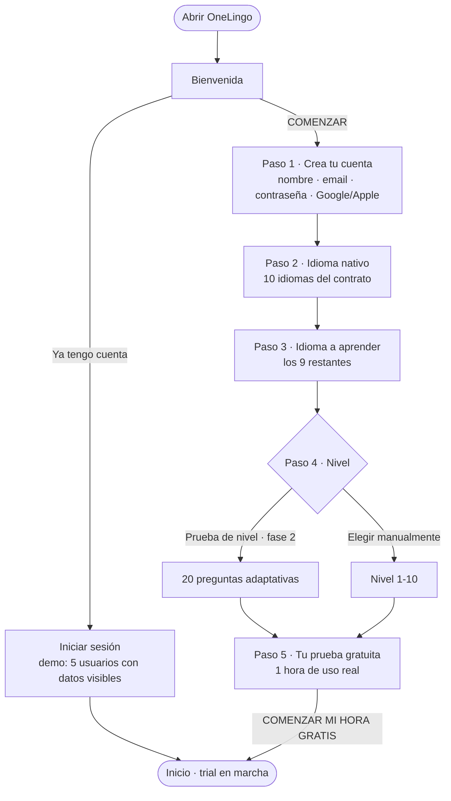
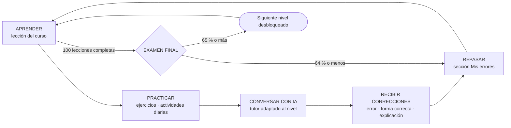
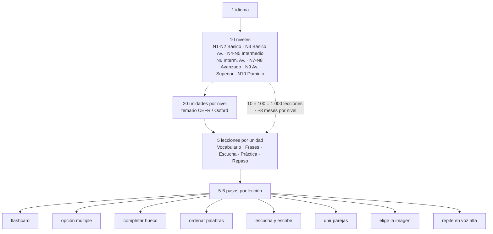
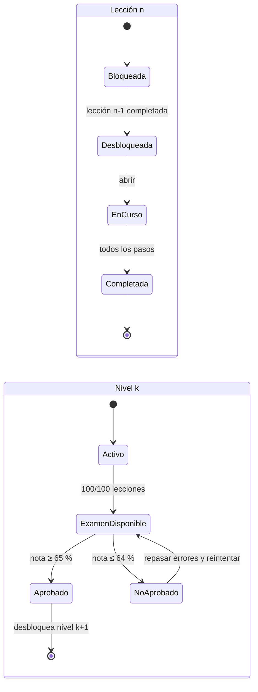
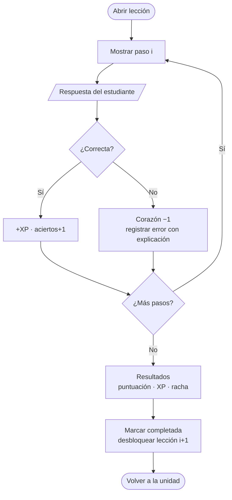
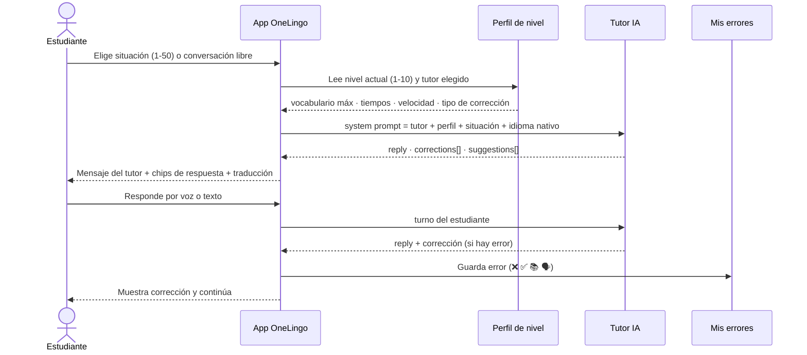
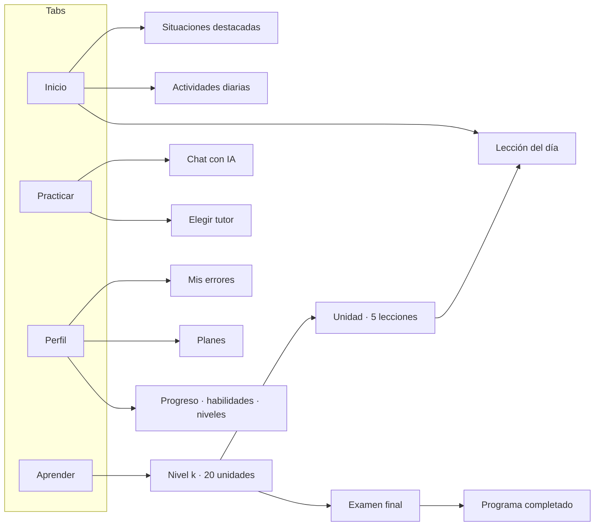
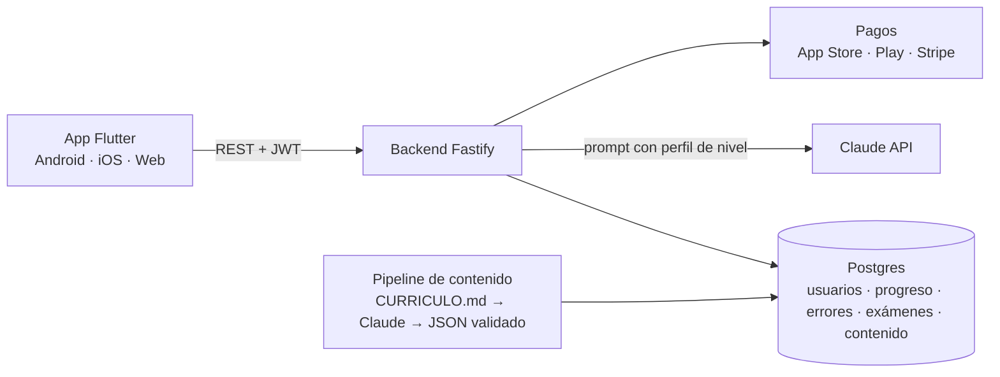

# OneLingo · Flujos (diagramas)

Los diagramas siguen el orden del viaje del usuario. Están en Mermaid: se
renderizan en GitHub, VS Code y en la página compartible generada para el cliente.

## 1. Primera experiencia y registro



## 2. El bucle de aprendizaje (estructura general del contrato)



## 3. Estructura del curso por idioma



## 4. Desbloqueo progresivo y examen final



Al aprobar el Nivel 10 se muestra la pantalla **Programa completado**.

## 5. Dentro de una lección



## 6. Práctica libre con IA (50 situaciones + conversación libre)



La misma situación cambia con el nivel: **Restaurante N1** = frases cortas y lentas;
**N5** = pedir recomendaciones y modificar la orden; **N10** = imprevistos, opiniones
y conversación espontánea. Solo cambia el perfil inyectado, no la situación.

## 7. Prueba gratuita y planes

```mermaid
flowchart TD
  R([Registro completo]) --> T[Trial · 60 min de uso real<br/>latido cada 30 s mientras la app está abierta]
  T --> C{¿Minutos restantes?}
  C -->|Sí| USO[Todas las funciones disponibles]
  USO --> T
  C -->|No| PL[Planes]
  PL --> P1[1 idioma · $20/mes]
  PL --> P2[2 idiomas · $30/mes]
  PL --> P3[3 idiomas · $40/mes]
  P1 --> SEL[Elegir idioma(s) del plan]
  P2 --> SEL
  P3 --> SEL
  SEL --> H([Progreso independiente por idioma])
```

## 8. Mapa de navegación de la app



## 9. Arquitectura (fase 2)


